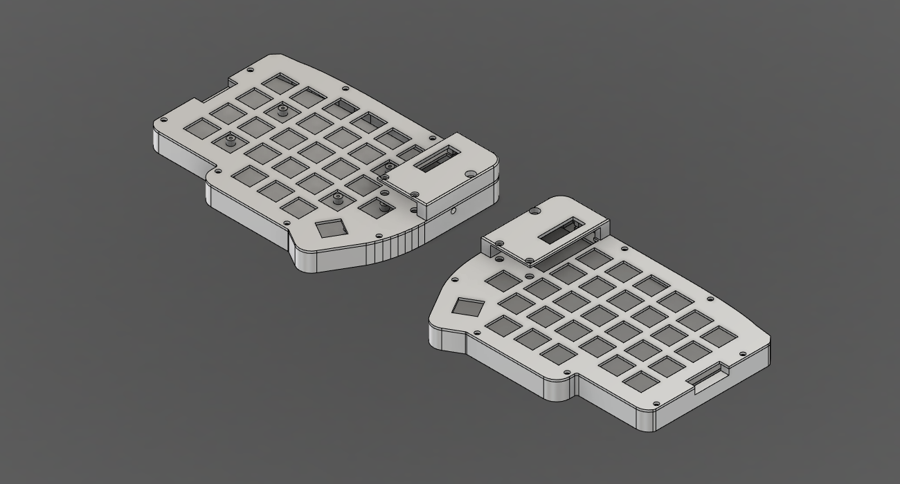

# Behuizing in Fusion — parametrisch (v0.4)

Status: 12 november 2026. De behuizing uit [13-behuizing.md](13-behuizing.md) staat nu parametrisch in het Fusion-document **"Opzet 1-0-0"** (map Toetsenbord): rechterhelft gemodelleerd, linkerhelft als spiegeling. Het numpad staat nog niet in Fusion.

Het document is opgeslagen in Fusion (12 nov, 22:20, na v0.4).

Opbouwscript: [`behuizing/fusion/opbouw_helften.py`](../behuizing/fusion/opbouw_helften.py). Het verwijdert alles na de schets "PCB omtrek" en bouwt de tijdlijn opnieuw op (stap 0 t/m 6).

## Wat er in het document staat

| Component | Massa (alu 6061) |
|---|---|
| Bak rechts / Bak links | 265,4 g |
| Plaat rechts / Plaat links | 41,5 g |
| Kap rechts / Kap links | 19,3 g |
| Print rechts (referentie, 1,6 mm) | — |

Per helft 326,2 g aluminium (CadQuery v0.1: 328 g). Tijdlijn: 65 stappen, alles gezond. Alle nieuwe schetsen zijn volledig bepaald.

## Gebruikersparameters

Naast `uitsparing` en `duimhoek`:

| Naam | Waarde | Doel |
|---|---|---|
| `plaat_dikte` | 1,5 mm | W6 |
| `pcb_dikte` / `pcb_plaat` / `vrij_onder` | 1,6 / 5 / 3,5 mm | hoogte-opbouw |
| `bodem` / `wand` / `spleet` | 4 / 7 / 1 mm | bak |
| `conn_diepte` | 9 mm | **schatting**, opmeten na levering connector |
| `jnp_rand` | 2,06 mm | pennenrij J_NP tot printrand |
| `r_buiten` / `r_binnen` | 3 / 1,5 mm | afrondingen (E22) |
| `kap_hoogte` / `kap_dak` | 10 / 2 mm | kap |
| `keycap` | 18 mm | bepaalt de rand van de kap |
| `m3_gat` / `m3_vrij` / `m2_gat` / `bus_d` | 2,5 / 3,4 / 1,6 / 5 mm | schroeven en steunbussen |
| `voet_d` / `voet_diepte` | 10 / 1 mm | rubbervoetjes |
| `helft_afstand` | 40 mm | ruimte tussen de helften in het model |

Afgeleid: `z_pcb_onder`, `z_pcb_boven`, `z_plaat_boven`, `z_wand`, `wand_pink` (= `conn_diepte − jnp_rand − spleet` = 5,94 mm).

## Wijzigingen ten opzichte van v0.1 (CadQuery)

1. **Printrand als 24 lijnen en 5 bogen** in plaats van 120 lijnstukjes, en 6 mm breder aan de pinkkant (route 2). Oppervlak 13.552,5 mm². Grootste afwijking van de Gerber-punten: 0,02 mm (boogje bij de duimpunt). Gevolg: gladde wanden (bak 128 vlakken) en een model dat heel blijft als `wand` of `conn_diepte` verandert.
2. **Plaat: USB en TRRS zijn één sleuf.** In v0.1 bleef tussen de twee uitsparingen een los stukje plaat van 3,1 × 8 mm staan (37 mm³), dat nergens aan vastzat.
3. **Bovenrand van de kap afgerond** (0,8 mm); dat lukte in CadQuery niet.
4. Buitenhoeken: de offset maakt aan de twee scherpe printhoeken rechtsboven een verstek in plaats van een boog. De twee holle hoeken van de buitencontour zijn afgerond met `r_binnen`, de twee hoeken van het connectorvlak met `r_buiten`.

## Controle (v0.2)

- Volume per deel tegenover CadQuery v0.1: bak 98.371 / 98.356 mm³, plaat 15.361 / 15.359 mm³ (v0.1 zonder het losse stukje), kap 7.554 / 7.579 mm³ (verschil door de afronding).
- Botsingscontrole bak, plaat, kap, print: 0 botsingen. Print ligt op de steunbussen; print tot plaat 3,5 mm.
- Parametertest (waarde gewijzigd, tijdlijn gecontroleerd, teruggezet): `conn_diepte` 6,5 / 8 / 10 mm, `wand` 8 mm, `spleet` 0,5 mm, `plaat_dikte` 1,2 mm, `bodem` 3 mm, `kap_hoogte` 12 mm, `duimhoek` 20°: alles gezond.
- `wand` 6 mm: alleen "Afronding bovenrand kap" faalt (de verzonken M3-kop van 6 mm past niet meer in de wand).
- `conn_diepte` boven 10,06 mm: het connectorvlak valt dan buiten de buitencontour; dan moet `wand` omhoog.

## v0.3: drie punten opgelost (12 nov, keuze Harm)

1. **Resetgat is een sleuf** van 3,5 mm breed, van het gat tot de bovenkant van de wand; de plaat sluit hem af. Het dunne randje van 0,25 mm is weg.
2. **USB en TRRS: één opening** in bak en kap (23,1 mm breed); het pilaartje van 3,1 mm is weg. Onder de TRRS loopt de opening 1,5 mm dieper door, zoals eerst.
3. **M2 in de kap: verzinking 90°** (ø4,0 aan het oppervlak, voor verzonken schroeven) in plaats van een verzonken cilinderkop ø4,4. Afstand tot de rand van de kap aan het oppervlak 0,5 mm, daaronder snel meer.

Na de wijziging: tijdlijn gezond, bak 98.291 mm³, kap 7.142 mm³, plaat ongewijzigd.

## v0.4: draaiknop (12 nov, besluit Harm: op beide helften, indrukbaar)

De knop komt op de plek van de binnenste toets, direct onder de Pro Micro (masterpunt −57,2; −51,29), zoals bij de Lily58L. Per helft 28 toetsen en één knop. In Fusion staat hij als referentie-onderdeel ("Draaiknop rechts/links (referentie)"): huis 12 × 12 × 6,5 mm, as ø6 tot 20 mm boven de print, knop ø15 × 13 mm, 2 mm boven de plaat. **Deze maten zijn aannames voor een EC11; aanpassen zodra het onderdeel gekozen is** (parameters `enc_*` en `knop_*`).

Controle: 0 botsingen; knop tot kap 2,5 mm; huis tot plaatuitsparing 1,0 mm rondom; bovenkant knop 5 mm boven de kap. De plaat hoeft niet te veranderen (uitsparing 14 × 14 mm). Knop maximaal ø19 mm.

**De print is hiervoor nog niet aangepast.** Nodig: EC11-footprint op die toetspositie, draaisignalen naar twee vrije pennen van de Pro Micro (F4 en F5 zijn vrij), drukfunctie op de matrixplek van die toets. Nog na te kijken in de KiCad-bestanden van de Lily58L: exacte footprint en pennen, en of de hotswap-voet op die plek kan blijven.

## Blijft staan

- De M3-posities zijn gekoppeld aan de hartlijn van de wand, maar de verdeling langs de wand is vast (uit `behuizing.py`).
- `wand` 6 mm: de verzonken M3-kop van 6 mm past dan niet meer in de wand van de kap.

## Nog te doen

- **Print aanpassen voor de draaiknop** (vóór de bestelling): Lily58L-bestanden bekijken, footprint plaatsen, routeren, DRC, nieuwe Gerbers. De KiCad-bestanden staan sinds 13 nov in [`pcb/`](../pcb).

- STEP/STL uit Fusion exporteren naar `behuizing/export/`.
- Numpad in Fusion (bak en plaat).
- Stuklijst met schroeven, afstandsbussen en voetjes (E19).
- Na levering van de connector: `conn_diepte` aanpassen.
